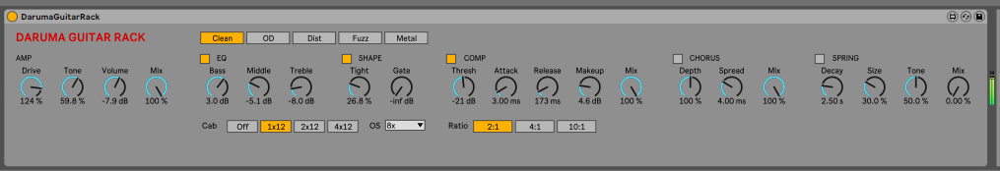

# MaxForLive

A collection of Max for Live devices for Ableton Live.

## Devices

### [Daruma Guitar Rack](DarumaGuitarRack/README.md)

[](DarumaGuitarRack/README.md)

Audio effect for electric guitar (Live 11 / Max 8), DSP written in gen~. One device chains a noise gate, tight filter,
oversampled distortion with five modes (Clean, OD, Dist, Fuzz, Metal), 3-band EQ, cabinet simulation, glue compressor,
static chorus and spring reverb.

[Read the docs →](DarumaGuitarRack/README.md)

## Requirements

- Ableton Live 11 or later, Suite edition (or Standard with the Max for Live add-on).
- Nothing else to use a device: each one ships as a ready-built `.amxd` file.

## Use a device in Ableton Live

1. Get the files: `git clone git@github.com:leonardoserra/MaxForLive.git`, or on GitHub click **Code → Download ZIP**.
2. Open the device's folder (for example `DarumaGuitarRack/`) and drag its `.amxd` file onto an audio track in Live.
   Drop it after the input, or where you want it in the device chain.
3. To find it again from Live's browser, add the repo folder under **Places → Add Folder…**, or copy the `.amxd` into
   your User Library (`User Library/Presets/Audio Effects/Max Audio Effect/`).

Live loads the `.amxd` when the device is added. After rebuilding a device, delete it from the track and drag it in
again to pick up the changes.

## Build a device from source

Each device is generated by a build script from its sources (the gen~ code in the `.genexpr` file and the layout in
the script). Rebuild after editing either; the script rewrites the `.amxd` (and a `.maxpat` copy, which is not committed).

The build script is plain bash and needs no extra tools. Run it from a terminal:

- **macOS / Linux:** the default terminal (bash or zsh).
- **Windows:** **Git Bash**, which comes with [Git for Windows](https://git-scm.com/download/win).

```sh
cd DarumaGuitarRack
./build.sh
```

If you get "permission denied", run `chmod +x build.sh` once, or start it with `bash build.sh`.
